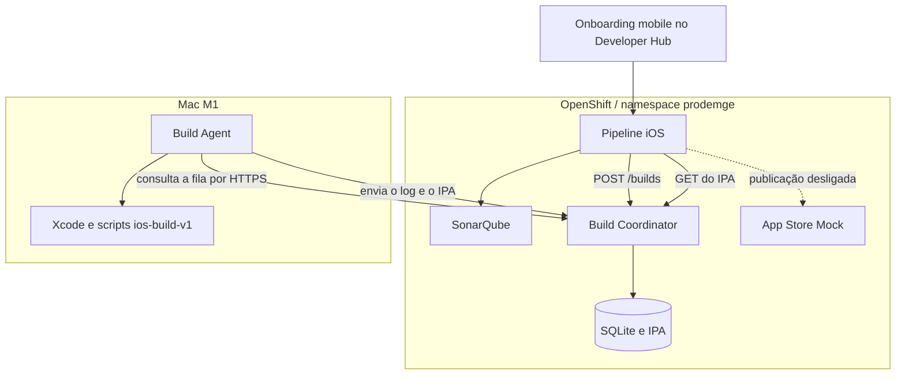
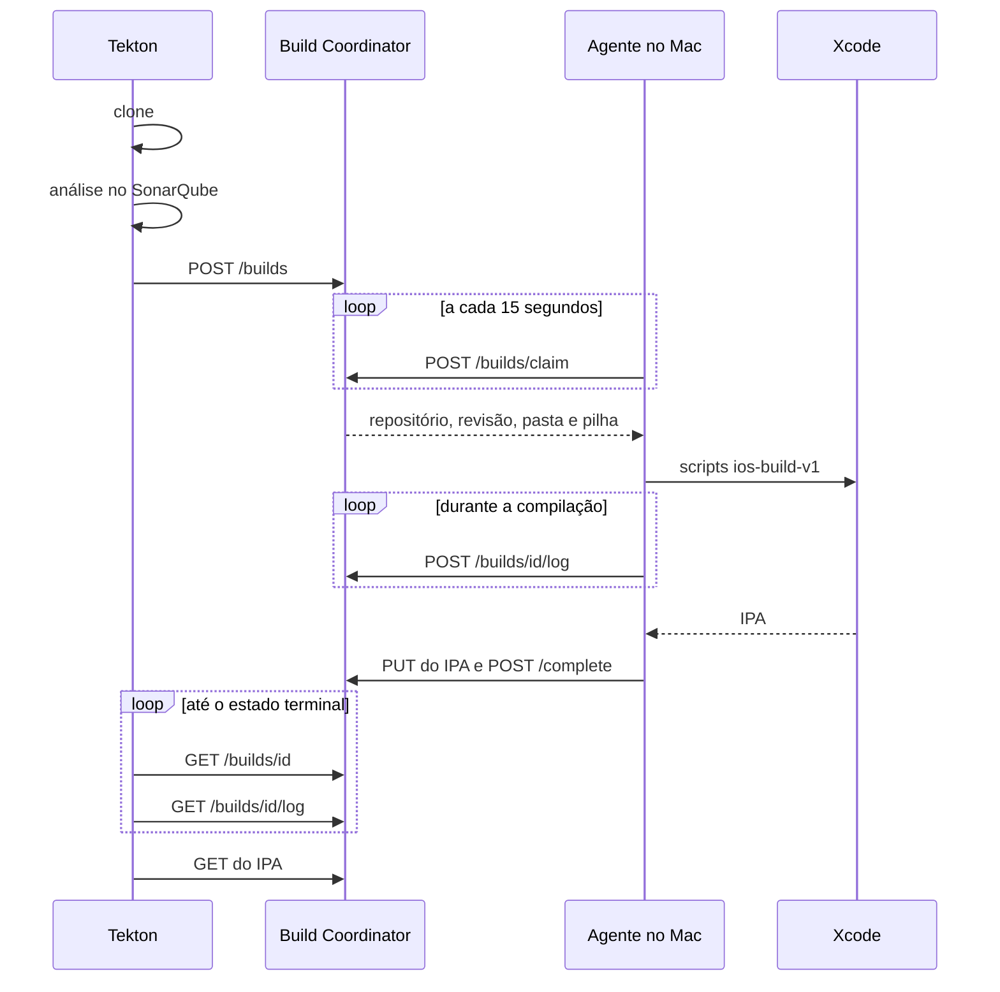

# Executor iOS no Mac

O caminho usado pelo Tekton é o agente local. Ele consulta o Build Coordinator no OpenShift, executa os scripts desta pasta `ci/` e devolve o IPA. O GitLab Runner continua instalado, mas a esteira não dispara mais o GitLab CI.

O coordenador e o contrato do agente estão em `macos-build-coordinator/` e `macos-build-agent/`. O agente só aceita o conjunto `ios-build-v1` e os sete scripts desta pasta. A API não envia comandos de shell.

## Solução

O Developer Hub gera o pipeline. O Tekton, no OpenShift, clona o código, publica a análise no SonarQube e registra o pedido no Build Coordinator. O agente no Mac M1 consulta a fila por HTTPS, executa os scripts desta pasta com o Xcode e devolve o IPA. O Tekton baixa esse arquivo. A publicação na App Store Mock permanece desligada. O pipeline Android segue no próprio cluster, com Gradle, e não passa pelo coordenador.





O GitLab Runner permanece instalado no Mac e fica fora deste caminho. O coordenador é um componente do laboratório, no Deployment `macos-build-coordinator`. Não é um executor macOS do OpenShift Pipelines.

## GitLab Runner

O texto abaixo descreve o runner que ficou no Mac. Ele não faz parte do caminho atual da esteira.

O GitLab do laboratório é o Community Edition 18.10.1. O Runner instalado é o binário oficial 18.10.1 para Apple Silicon, conferido pelo `release.sha256` publicado em `gitlab-runner-downloads`. Ele não vem do Homebrew, cuja fórmula acompanha uma linha mais nova.

O binário fica em `~/.local/bin/gitlab-runner`. O serviço é um LaunchAgent do usuário, não um daemon de root. A configuração fica em `~/.gitlab-runner/config.toml`, com permissão restrita ao usuário. O token do runner não entra no Git.

O runner é do tipo projeto, preso a `development/ios-build`. As tags são `macos`, `apple-silicon` e `ios-build`. Ele não executa job sem essas tags, não atende outros projetos e só aceita branch protegida. A concorrência é um job por vez. Os diretórios de trabalho são `~/gitlab-runner/builds` e `~/gitlab-runner/cache`.

Ruby 3.3 está instalado pelo Homebrew como keg e não substitui o Ruby 4 do `PATH`. O CocoaPods 1.15.2 desse Ruby fica em `/opt/homebrew/lib/ruby/gems/3.3.0/bin/pod`. O Node usado no build é o 24.12.0 já instalado pelo nvm, também sem trocar o Node padrão do Homebrew.

## Operação

Conferir a versão:

```bash
~/.local/bin/gitlab-runner --version
```

Conferir o serviço:

```bash
launchctl print "gui/$(id -u)/gitlab-runner"
```

Reiniciar o serviço:

```bash
~/.local/bin/gitlab-runner restart
```

Os logs ficam em `~/gitlab-runner/logs/gitlab-runner.out.log` e `~/gitlab-runner/logs/gitlab-runner.err.log`. O LaunchAgent é `~/Library/LaunchAgents/gitlab-runner.plist`.

## Pipeline Tekton

O Pipeline `ios-build-remote`, no namespace `prodemge`, executa nesta ordem: `clone`, `static-analysis`, `request-build`, `wait`, `fetch-ipa` e `publish`. O clone e o SonarQube rodam no OpenShift. O `request-build` registra o pedido no coordenador, o `wait` acompanha o agente do Mac e o `fetch-ipa` baixa o IPA dessa fila. O `publish` envia esse arquivo à App Store Mock.

Os PipelineRuns anteriores a essa alteração só têm `trigger` e `wait`. A visualização nova está no Pipeline, e numa execução criada depois da alteração.

## Build

O job `ios-build` só entra na esteira quando o Tekton envia `RUN_IOS=true`. Ele clona `SOURCE_URL` no `SOURCE_SHA`, instala npm e CocoaPods, descobre o workspace e o scheme do projeto e compila para o simulador. Em seguida faz o archive de device. Se o Mac tiver um provisioning profile para o bundle, o archive usa esse time e exporta um IPA de depuração para `exported/`. O `ci/collect-ipa.sh` copia o arquivo para `output/app.ipa`, que vai nos artefatos do job.

Sem certificado Apple e sem provisioning profile, o archive para com `IPA_STATUS=blocked-signing`. Esse resultado não é um IPA.

React Native 0.68.7 é recusado pelo script neste Xcode. A compilação Android dessa versão continua no Tekton, em Linux.

## Validação em 17 de novembro de 2026

O job de shell do pipeline 1 concluiu no macOS 26.7.2, arm64, com o usuário `raphaelmorsch`.

O PipelineRun `ios-build-remote-bs945` disparou o pipeline GitLab 5. O job compilou React Native 0.87.1, commit `18d2e468cc6080ff0c7f400db1426c62a385a37a`, scheme `SidsMobile`, e gerou `SidsMobile.app` para o simulador com Xcode 27.2. O archive de device falhou porque o alvo exige um development team. Nenhum IPA foi produzido.

Para remover o serviço sem apagar o binário:

```bash
~/.local/bin/gitlab-runner stop
~/.local/bin/gitlab-runner uninstall
```
