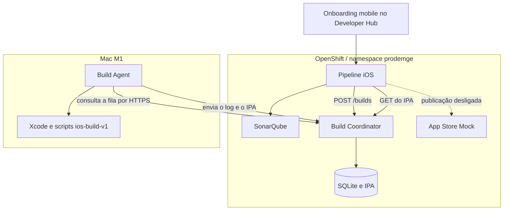

# Build Coordinator

Fila de builds iOS no OpenShift. O Tekton registra o pedido. O agente do Mac reserva um job, renova o lease e devolve o IPA. A API não aceita comando de shell: o único conjunto autorizado é `ios-build-v1`, e as pilhas aceitas são `rn-0.87.1` e `rn-0.88.1`.

O desenho completo, com a sequência das chamadas, está em `ios-build/README.md`.

O estado fica em SQLite no PVC `macos-build-coordinator-data`. Há duas credenciais no Secret `macos-build-api`: `token` para o Tekton e `agent-token` para o Mac. Nenhuma das duas entra no Git.

- `POST /builds` registra ou reaproveita um pedido. Um pedido que já falhou volta para a fila.
- `GET /builds/{id}` devolve o estado. Um lease vencido marca o build como falho.
- `GET /builds/{id}/artifact` baixa o IPA depois do sucesso.
- `POST /builds/claim` entrega o job mais antigo ao agente, um por vez.
- `POST /builds/{id}/heartbeat` renova o lease.
- `POST /builds/{id}/log` recebe trechos do log enquanto o build está em execução. O arquivo fica no PVC e `GET /builds/{id}/log` devolve o texto, a partir de `offset`.
- `PUT /builds/{id}/artifact` recebe o IPA.
- `POST /builds/{id}/complete` e `POST /builds/{id}/fail` encerram o job.

O Service interno é `http://macos-build-coordinator.prodemge.svc:8080`. O Mac usa a Route HTTPS. Este componente é específico do laboratório. Não é um executor macOS do OpenShift Pipelines.
